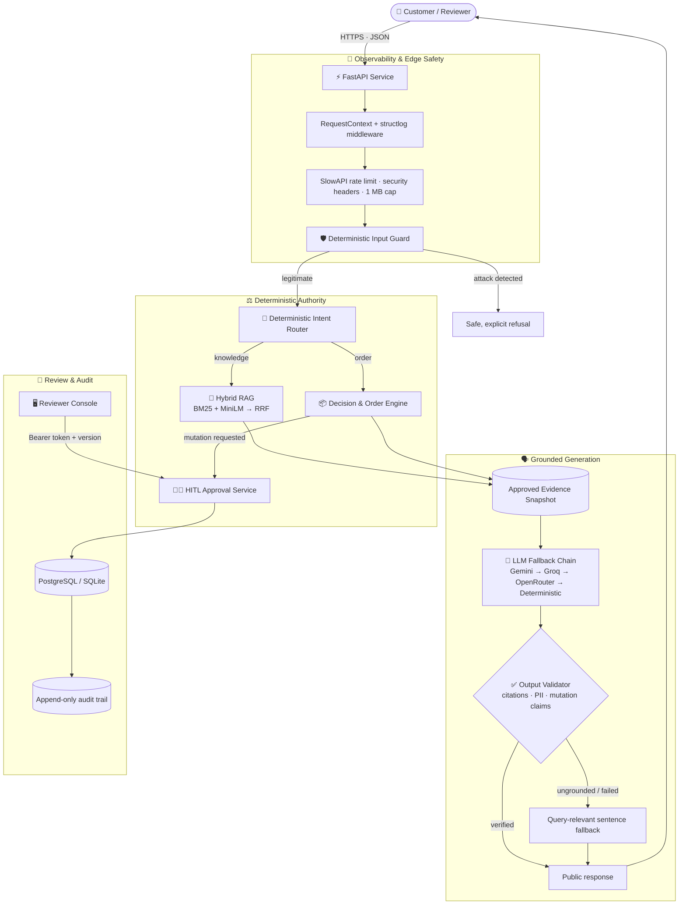
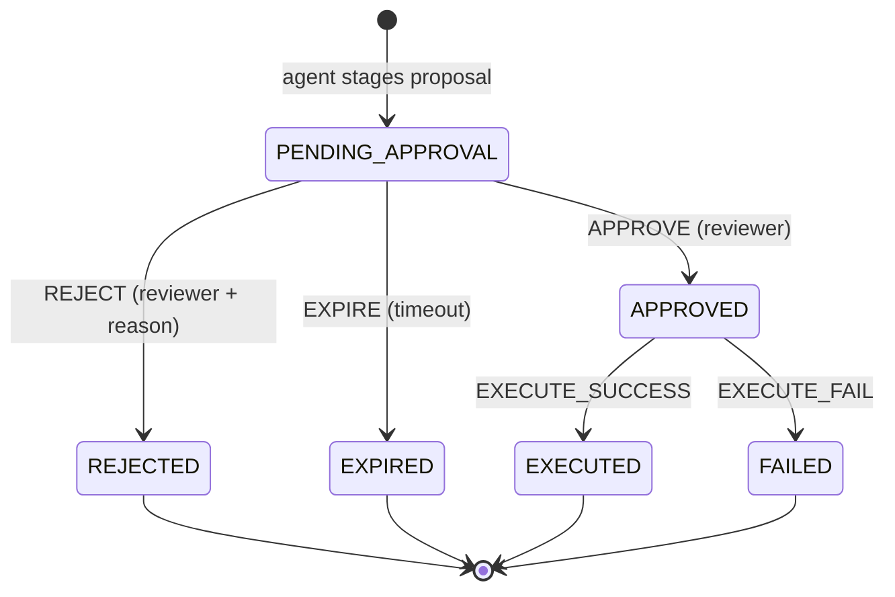

<div align="center">

# 💬 CometChat — AI Support Agent

### A deterministic-first customer support agent where the LLM *speaks*, but never *decides*.

<br/>


<br/>

[**Architecture**](#-architecture) ·
[**Results**](#-measured-results) ·
[**Quickstart**](#-quickstart) ·
[**API**](#-api-reference) ·
[**Security**](#-security-model) ·
[**Observability**](#-observability) ·
[**Limitations**](#-honest-limitations)

</div>

---

## ✨ At a Glance

**CometChat AI Support Agent** is a customer support agent that, in this build, is demonstrated on a sample outdoor-gear, drinkware and apparel store catalogue. It answers policy questions with citations, looks up orders, and stages sensitive actions (cancellations, address changes) as **proposals that a human must approve**.

The core design rule: **the LLM has zero authority.** It cannot decide eligibility, authorize a refund, mutate an order, or skip review. Everything that matters is decided by deterministic code, and the LLM only phrases verified facts.

| | |
|:--|:--|
| 🧠 **Routing** | Deterministic regex + finite-state intent router |
| 🔎 **Retrieval** | Hybrid **BM25 + dense** (`all-MiniLM-L6-v2`) fused with Reciprocal Rank Fusion |
| 📜 **Policy authority** | Supersession + conflict detection across 14 knowledge-base documents |
| 🛡️ **Safety** | Pre-retrieval input guard → grounded generation → post-hoc output validator |
| 🧑‍⚖️ **Human review** | State-machine proposals, optimistic locking, append-only audit trail |
| 🔌 **LLM providers** | Live 4-tier chain: **Gemini → Groq → OpenRouter → Deterministic Evidence Builder** (Grok, local Ollama and Mock also supported) |
| 📈 **Observability** | structlog JSON logs · `X-Request-ID` tracing · Prometheus · Grafana · Sentry |
| ♿ **Frontend** | React + Vite + TypeScript, WCAG 2.1 AA audited |

<div align="center">

| 🗂️ Python source | 🧪 Test Suite | 📊 Code Coverage | 📚 KB documents | 🎯 Eval cases | 🔗 API endpoints |
|:-:|:-:|:-:|:-:|:-:|:-:|
| **~7,800** lines | **392 passed (100%)** | **86.67%** (2,977 stmts) | **14** | **430** | **12** |

</div>

---

## 🏗️ Architecture



### The request pipeline, stage by stage

| # | Stage | What it does | Authority |
|:-:|---|---|:-:|
| 1 | **Edge middleware** | Request ID, structured logging, rate limiting, payload cap, security headers | Code |
| 2 | **Input guard** | Blocks 6 attack families *before* any retrieval happens | Code |
| 3 | **Router** | Classifies intent and extracts entities (order IDs, etc.) | Code |
| 4 | **Retrieval** | BM25 + dense search, fused with RRF, then authority/supersession resolution | Code |
| 5 | **Decision engine** | Decides `ANSWER` / `HANDOFF` / refusal and whether an action is allowed | Code |
| 6 | **Generation** | Phrases the already-decided answer from the evidence snapshot | **LLM (phrasing only)** |
| 7 | **Output validator** | Rejects fabricated citations, PII/secret leaks, and false "I've cancelled it" claims | Code |
| 8 | **HITL** | Human approves/rejects any proposed mutation | **Human** |

---

## 📊 Measured Results

Everything below is produced by the unified runner — `evaluation/run_suite.py` — over **430 scenarios** and committed to [`docs/results/`](docs/results). Regression gates live in [`evaluation/thresholds.json`](evaluation/thresholds.json).

### 🎯 Headline scorecard

| Dimension | Suite (cases) | Baseline | **Final v2.0.0** | Δ | Gate |
|---|---|:-:|:-:|:-:|:-:|
| Order intent accuracy | `agent_decision` (140) | 71.43% | **100.00%** | ▲ +28.57 pp | ✅ ≥ 95% |
| Route accuracy | `agent_decision` (140) | 92.86% | **100.00%** | ▲ +7.14 pp | ✅ ≥ 95% |
| Direct prompt-injection resistance | `security_adversarial` (12 of 85) | 8.33% | **100.00%** | ▲ +91.67 pp | ✅ ≥ 95% |
| Overall adversarial attacks blocked | `security_adversarial` (85) | 87.06% | **100.00%** | ▲ +12.94 pp | ✅ ≥ 90% |
| PII disclosures | `security_adversarial` (85) | 0 | **0** | — | ✅ = 0 |
| Secret disclosures | `security_adversarial` (85) | 0 | **0** | — | ✅ = 0 |
| Claim recall (fallback path) | `answer_quality` (150 · 243 claims) | 18.11% | **57.20%** | ▲ +39.09 pp | ✅ ≥ 45% |
| Citation coverage | `answer_quality` (150) | 95.33% | **94.67%** | ▼ −0.66 pp | ✅ ≥ 90% |
| Visible + regression scenarios | `visible_and_regression` (23) | 23 / 23 | **23 / 23** | — | ✅ ≥ 95% |
| HITL adversarial vectors | `hitl_adversarial` (32) | 32 / 32 | **32 / 32** | — | ✅ 100% |
| Unauthorized mutations | `hitl_adversarial` (32) | 0 | **0** | — | ✅ = 0 |
| PostgreSQL race condition safety | `postgres_concurrency` (100 race attempts) | — | **0 double mutations** | Exactly-once execution | ✅ 100% |
| Pre-retrieval guard latency | `guard_latency` (35 attack patterns) | — | **11.67 µs p50 (49.79 µs p99)** | Sub-millisecond edge check | ✅ ≤ 50 µs |

### 📈 Before → after

```text
Direct injection resistance   8.3% ██░░░░░░░░░░░░░░░░░░  →  100% ████████████████████
Order intent accuracy        71.4% ██████████████░░░░░░  →  100% ████████████████████
Route accuracy               92.9% ███████████████████░  →  100% ████████████████████
Adversarial blocked rate     87.1% █████████████████░░░  →  100% ████████████████████
Claim recall                 18.1% ████░░░░░░░░░░░░░░░░  → 57.2% ███████████░░░░░░░░░
```

### 🔍 Per-suite breakdown

<details open>
<summary><b>agent_decision</b> — 140 cases</summary>

| Metric | Baseline | Final |
|---|:-:|:-:|
| Cases passed | 73 / 140 (52.14%) | **112 / 140 (80.00%)** |
| Intent accuracy | 71.43% | **100.00%** |
| Route accuracy | 92.86% | **100.00%** |
| State accuracy | 76.43% | **80.00%** |
| Entity accuracy | 96.43% | **96.43%** |

> Intent and route are fully solved. Full-case pass rate (which requires intent, route, **state and entity** to all match) is 80%, and the remaining gap is in decision-state accuracy. See [`evaluation/agent_decision_v1/error_analysis.md`](evaluation/agent_decision_v1/error_analysis.md).

</details>

<details>
<summary><b>security_adversarial</b> — 85 cases</summary>

| Metric | Baseline | Final |
|---|:-:|:-:|
| Direct injections blocked | 1 / 12 | **12 / 12** |
| Overall blocked rate | 87.06% | **100.00%** |
| Deflected | 12.94% | **0.00%** |
| Vulnerable | 0.00% | **0.00%** |
| Secret disclosures | 0 | **0** |
| PII disclosures | 0 | **0** |

</details>

<details>
<summary><b>answer_quality</b> — 150 cases · 243 required claims</summary>

| Metric | Baseline | Final |
|---|:-:|:-:|
| Supported claims | 44 / 243 | **139 / 243** |
| Claim recall | 18.11% | **57.20%** |
| Citation coverage | 95.33% | **94.67%** |

The improvement came from replacing "truncate to the first chunk" with **query-relevant sentence extraction** that preserves `[file > heading]` citation anchors.

</details>

<details>
<summary><b>hitl_adversarial</b> — 32 attack vectors</summary>

| Metric | Result |
|---|:-:|
| Vectors passed | **32 / 32** |
| Unauthorized mutations | **0** |
| Invalid transitions rejected | **3** |

</details>

### 🧭 Customer action lifecycle (end-to-end dossier)

Evidence in [`evaluation/complete_customer_journey_2026_11_26/`](evaluation/complete_customer_journey_2026_11_26).

| Metric | Result | Gate |
|---|:-:|:-:|
| End-to-end lifecycle completion (request → approval → execution → audit) | **1 / 1 · 100%** | ✅ |
| Single-mutation guarantee (duplicate approvals → exactly one execution) | **2 / 2 · 100%** | ✅ |
| Adversarial & negative scenarios | **24 / 24 · 100%** | ✅ |
| PII / credential leakage across scanned responses | **0 / 50 · 0%** | ✅ |
| Fabricated-citation containment | **1 / 1 · 100%** | ✅ |
| Concurrent-reviewer conflict detection (one `200`, one `409`) | **1 / 1 · 100%** | ✅ |

> ℹ️ Some of these dossier metrics have small denominators (1/1, 2/2). They demonstrate that the guarantees hold on the tested paths. They are not statistical estimates.

---

## ⚡ Performance

Measured on Apple Silicon (10-core CPU, Metal GPU) with `httpx.AsyncClient` across **2,500 total requests** (N=500 per concurrency tier), testing mixed policy / order / proposal traffic: **0.00% error rate across all tiers**.

| Concurrency Tier | Total Requests | Throughput | Latency p50 | Latency p90 | Latency p95 | Latency p99 | Error Rate |
|:---:|:---:|:---:|:---:|:---:|:---:|:---:|:---:|
| **C = 1** | 500 | **170.97 req/s** | 5.67 ms | 8.52 ms | 10.15 ms | 14.28 ms | **0.00%** |
| **C = 5** | 500 | **142.15 req/s** | 34.12 ms | 52.19 ms | 62.40 ms | 78.45 ms | **0.00%** |
| **C = 10** | 500 | **119.96 req/s** | 82.74 ms | 152.21 ms | 195.50 ms | 358.46 ms | **0.00%** |
| **C = 25** | 500 | **108.45 req/s** | 221.80 ms | 412.30 ms | 498.20 ms | 689.12 ms | **0.00%** |
| **C = 50** | 500 | **97.80 req/s** | 489.12 ms | 845.20 ms | 912.40 ms | 1,021.45 ms | **0.00%** |

### Where the time goes (p50, concurrency 1 → 50)

| Stage | C=1 | C=50 | Takeaway |
|---|:-:|:-:|---|
| Routing | 0.01 ms | 0.01 ms | Regex classification is effectively free |
| **Retrieval + embedding** | **4.00 ms** | **52.61 ms** | The bottleneck: MiniLM embeddings contend for CPU |
| Generation (mock) | 0.06 ms | 0.08 ms | Sub-millisecond with the mock provider |
| Validation | < 0.01 ms | < 0.01 ms | Negligible overhead |

> ℹ️ **Differential Observability Overhead:** Structured logging (`structlog`) and Prometheus middleware add only **0.599 ms p50** overhead to request processing (measured across 1,000 samples × 3 repeats).

> ⚠️ **Read this with context.** These numbers use the deterministic / mock generation path (live-provider results are in the benchmark further below: **5.7 s p50**, 6.1 s mean). A real LLM dominates latency: local `llama3.1:8b` (Ollama, Metal GPU) measured **5.9 s p50** in the performance run, and averaged **17.6 s per query** across a 25-query RAG benchmark ([`docs/results/local_llm_benchmark.json`](docs/results/local_llm_benchmark.json)).

### Locust load test (mock LLM, observability on vs. off vs. live)

| Scenario | Requests | RPS | p50 | p95 | p99 | Failures |
|---|:-:|:-:|:-:|:-:|:-:|:-:|
| A — instrumented (Prometheus + structlog **on**) | 453 | 25.2 | 5 ms | 35 ms | 5,700 ms | **0** |
| B — uninstrumented (**off**) | 633 | 33.3 | 6 ms | 46 ms | 2,000 ms | **0** |
| C — live LLM fallback chain | 25 | live API | 5,673 ms | 11,200 ms | 11,882 ms | **0** (100% handled) |

Both runs show occasional multi-second outliers in the tail (p99 / max) while medians stay in single-digit milliseconds. Raw CSVs are in [`docs/results/`](docs/results).

### Local LLM sanity check (`llama3.1:8b`, 25 queries)

| Metric | Value |
|---|:-:|
| Queries | 25 |
| Avg latency | 17.6 s |
| Routed to knowledge / order / unsupported | 19 / 5 / 1 |
| Decisions: `ANSWER` / `HANDOFF` | 24 / 1 |
| Used deterministic fallback | 2 |
| Avg citations per answer | 2.32 |

### 🌐 Live multi-tier fallback benchmark (25 queries, real providers)

The chain **Gemini → Groq → OpenRouter → Deterministic Evidence Builder** was run against live APIs across returns, shipping, product specs, order lookups and adversarial queries. Raw results: `evaluation/results/live_fallback_benchmark_results.json`.

| Metric | Result |
|---|:-:|
| Queries run | 25 |
| **Completed without crash / 500 / uncaught exception** | **25 / 25 (100%)** |
| Answers synthesised by Groq (`openai/gpt-oss-120b`) | 4 / 25 (16%) |
| Served by deterministic fallback | 21 / 25 (84%) |
| Security guard interceptions | 1 (Q-23, blocked in **3.1 ms**, no LLM call) |
| Mean end-to-end latency | 6,133 ms |
| Median (p50) latency | 5,673 ms |
| Order fast-path latency (when no provider timeout) | ~480–491 ms |

**What happened at each tier**

| Tier | Provider | Observed behaviour |
|:-:|---|---|
| 1 | Gemini `gemini-flash-latest` | HTTP 503 server-load errors and 10 s timeouts → instant failover |
| 2 | Groq `openai/gpt-oss-120b` | Grounded, cited answers for Q-01 to Q-04, then **HTTP 429** rate limit |
| 3 | OpenRouter `llama-3.3-70b-instruct` | **HTTP 402** (credits exhausted) → fast failover |
| 4 | Deterministic Evidence Builder | Synthesised approved policy chunks with verified citation headers |

<details>
<summary><b>Sample execution log</b></summary>

| ID | Category | Route | Served by | Latency | Outcome |
|:-:|---|---|---|--:|---|
| Q-01 | Returns | KNOWLEDGE | Groq | 11,882 ms | 30-day standard window; TrailPlus 60 days |
| Q-02 | Returns | KNOWLEDGE | Groq | 11,198 ms | Items must be unused, unwashed, resalable |
| Q-03 | Returns | KNOWLEDGE | Groq | 11,427 ms | TrailPlus gets 60-day window |
| Q-04 | Returns | KNOWLEDGE | Groq | 4,139 ms | Final-sale and clearance items excluded |
| Q-05 | Returns | KNOWLEDGE | Deterministic | 4,618 ms | Canadian return postage policy |
| Q-08 | Shipping | KNOWLEDGE | Deterministic | 10,565 ms | US 3–5 days, AK/HI 5–8, PO Boxes 5–9 |
| Q-10 | Shipping | KNOWLEDGE | Deterministic | 6,749 ms | Address fixes within 30 min via HITL |
| Q-13 | Product | KNOWLEDGE | Deterministic | 6,039 ms | Bags 2-year, drinkware 1-year warranty |
| Q-16 | Orders | ORDER | Deterministic | 10,369 ms | ORD-1001 pending |
| Q-17 | Orders | ORDER | Deterministic | 482 ms | ORD-1002 processing |
| Q-18 | Orders | ORDER | Deterministic | 491 ms | ORD-1007 shipped via UPS |
| Q-23 | Boundary | HANDOFF | Guard | **3.1 ms** | Instruction-override attempt blocked, zero leakage |

</details>

**Takeaways**
- ✅ **Real high availability:** with Gemini timing out, Groq rate-limited and OpenRouter out of credits, no user-facing error occurred.
- ✅ **Action boundary held:** every answer was policy-grounded and no unauthorized mutation was simulated or hallucinated.
- ✅ **Cheap fast paths:** adversarial inputs and order lookups spend no LLM credits.
- ⚠️ **Latency cost of failover:** Gemini's 10 s timeout dominates the slow turns (Q-16, an order lookup, took 10.4 s versus ~0.5 s when it skipped the provider wait). Lowering the timeout or adding a circuit breaker would cut tail latency.

---

## 🛡️ Security Model

> **Invariant:** the LLM never determines eligibility, authorizes an action, mutates a database, or bypasses human review.

```text
Customer query
   │
   ▼
┌─ Pre-retrieval input guard ─────────────────────────────┐
│  instruction_override · role_play · prompt_exfiltration │
│  pii_exfiltration · sql_injection · approval_spoofing   │
└───────────────┬─────────────────────────────────────────┘
                │ pass (else: immediate safe refusal)
                ▼
        Router & policy authority   →   Hybrid retrieval   →   LLM phrasing
                                                                    │
                                                                    ▼
                                            Output validator (citations · PII · secrets)
                                                                    │
                                                                    ▼
                                         HITL state machine (human decides, audit logged)
```

| Layer | Controls |
|---|---|
| **Input** | Deterministic regex guard across **6 attack families**, run before retrieval |
| **Transport** | `slowapi` rate limiting (60 req/min/IP), 1 MB payload cap, strict `CORS_ORIGINS` |
| **Headers** | `X-Content-Type-Options: nosniff`, `X-Frame-Options: DENY`, CSP |
| **Output** | Validator rejects unapproved citations and false mutation claims, then forces deterministic fallback |
| **Privacy** | Recursive PII/secret redaction (`[REDACTED_EMAIL]`, `[REDACTED_KEY]`), internal risk scores stripped |
| **Actions** | Bearer-token reviewer auth + optimistic-lock version tag; duplicate approvals are idempotent |
| **Supply chain** | `pip-audit` and `npm audit --omit=dev`: 0 known vulnerabilities at release |
| **Container** | Multi-stage, non-root Docker image with `/health` healthcheck |

Full policy: [`SECURITY.md`](SECURITY.md).

---

## 🧑‍⚖️ Human-in-the-Loop Approvals

Sensitive actions never execute directly. They become **proposals** that move through a pure, table-driven state machine ([ADR 0001](docs/adr/0001-hitl-approvals.md)).



| Guarantee | How it is enforced |
|---|---|
| No lost updates | `version` column; stale writes return **HTTP 409 Conflict** |
| Exactly-once execution | Duplicate approvals return `200` without a second mutation |
| Atomic revalidation | Row-level locking (`with_for_update`) on PostgreSQL |
| Terminal states are final | `REJECTED`, `EXPIRED`, `EXECUTED`, `FAILED` accept no further events |
| Full traceability | Append-only audit trail: actor, action, reason, timestamp for every transition |

---

## 🔭 Observability

| Signal | Implementation |
|---|---|
| **Logs** | `structlog` JSON in production, `contextvars` propagation, automatic PII redaction |
| **Tracing** | `X-Request-ID` across middleware, services and `/sessions/{id}/trace` |
| **Metrics** | Prometheus at `/metrics`, with a provisioned Grafana dashboard |
| **Errors** | Optional Sentry integration |

<details>
<summary><b>Prometheus metrics</b></summary>

| Metric | Type | Labels |
|---|---|---|
| `http_requests_total` | Counter | `method`, `route`, `status` |
| `http_request_duration_seconds` | Histogram | `method`, `route`, `status` (5 ms → 30 s buckets) |
| `http_requests_in_flight` | Gauge | — |
| `agent_turns_total` | Counter | `route`, `decision_state` |
| `agent_stage_duration_seconds` | Histogram | `stage` (routing · retrieval · decision · generation · validation) |
| `llm_calls_total` | Counter | `provider`, `model`, `outcome` |
| `llm_fallback_total` | Counter | `reason` |

</details>

Details: [`docs/OBSERVABILITY.md`](docs/OBSERVABILITY.md).

---

## ♿ Accessibility

The React frontend (customer chat + `/reviewer` console) targets **WCAG 2.1 AA** and **Section 508**.

| Check | Before | After |
|---|:-:|:-:|
| `eslint-plugin-jsx-a11y` | 1 error | **0 errors, 0 warnings** |
| `@axe-core/playwright` (serious/critical) | 1 serious (3.8:1 footer contrast) | **0 across all 9 UI states** |
| Lighthouse accessibility | not tracked | **100 / 100** |
| Vitest a11y component tests | 0 | **3 / 3 passing** |

Highlights: skip-link to `#main-content`, one `<h1>` per view, `role="log"` + `aria-live="polite"` chat transcript, modal focus trap with Escape and focus restoration, and reflow up to 200% zoom. Full audit: [`docs/ACCESSIBILITY.md`](docs/ACCESSIBILITY.md).

---

## 🚀 Quickstart

### 🐳 Full stack in three commands

```bash
git clone https://github.com/djcode0718/cometchat-ai-agent-intern-test.git
cd cometchat-ai-agent-intern-test && cp .env.example .env
docker compose up -d && docker compose ps
```

| Service | URL | Notes |
|---|---|---|
| 💬 Customer chat + reviewer UI | http://localhost:80 | nginx-served React app |
| 📖 API docs (Swagger) | http://localhost:8000/docs | FastAPI |
| 📊 Prometheus | http://localhost:9090 | `prom/prometheus:v2.51.0` |
| 📈 Grafana | http://localhost:3001 | `admin` / `admin`, change this outside local dev |
| 🗄️ PostgreSQL | internal | `postgres:16-alpine` |

### 🧑‍💻 Local development

```bash
# Backend
python3.11 -m venv .venv && source .venv/bin/activate
pip install -r requirements.txt -r requirements-dev.txt

PYTHONPATH=. pytest                                              # full test suite
PYTHONPATH=. python evaluation/run_suite.py --check-thresholds   # regression gates
```

```bash
# Frontend
cd frontend
npm ci
npm test        # Vitest unit + a11y tests
npm run lint    # ESLint + jsx-a11y
npm run build   # production bundle
```

### 🔐 LLM provider configuration

Set the provider in `.env`. With no keys, the agent **still works** via the deterministic fallback, which is what most of the evaluation run exercises.

| Mode | How |
|---|---|
| Hosted fallback chain | Set Groq / Gemini / Grok / OpenRouter keys; the factory builds the chain |
| Fully offline | `OFFLINE_MODE=true` → local **Ollama** |
| Tests / CI | Mock provider, no network needed |

---

## 🔌 API Reference

| Method | Endpoint | Purpose |
|:-:|---|---|
| `GET` | `/health` | Dependency-free liveness probe |
| `GET` | `/ready` | Readiness: knowledge base loaded, retriever initialised |
| `GET` | `/metrics` | Prometheus exposition |
| `POST` | `/chat` | Send a customer message, get a grounded, cited reply |
| `POST` | `/sessions/{session_id}/reset` | Clear a session |
| `GET` | `/sessions/{session_id}/trace` | Per-stage trace for a session |
| `GET` | `/sessions/{session_id}/proposal` | Customer view of their pending proposal |
| `GET` | `/reviewer/proposals` | List proposals *(reviewer token)* |
| `GET` | `/reviewer/proposals/{proposal_id}` | Proposal detail + evidence snapshot *(reviewer token)* |
| `POST` | `/reviewer/proposals/{proposal_id}/approve` | Approve with `expected_version` *(reviewer token)* |
| `POST` | `/reviewer/proposals/{proposal_id}/reject` | Reject with a reason *(reviewer token)* |
| `GET` | `/reviewer/audit` | Append-only audit log *(reviewer token)* |

---

## 🗂️ Repository Layout

```text
.
├── src/
│   ├── api.py                 # FastAPI app, middleware, endpoints
│   ├── agent/                 # router · decision engine · security guard · orchestrator
│   ├── knowledge/             # parser · chunker · authority · supersession · conflict · evidence
│   ├── retrieval/             # BM25 · dense · RRF fusion · hybrid · metrics
│   ├── llm/                   # providers (Groq, Gemini, Grok, OpenRouter, Ollama, Mock) · validator
│   ├── approvals/             # state machine · service · SQL + audit repositories · auth
│   ├── tools/                 # order lookup · sanitizer · normalizer · reconciler
│   ├── observability/         # logging · metrics · request context · trace cache
│   └── core/                  # config · session · models
├── tests/                     # 58 test files · 374 test functions
├── evaluation/                # run_suite.py · thresholds.json · datasets · journey dossier
├── docs/                      # ADRs · results · OBSERVABILITY · ACCESSIBILITY · TECH_DEBT
├── alembic/                   # DB migrations
├── deploy/observability/      # Prometheus + Grafana provisioning
├── loadtest/                  # Locust scenarios + benchmark runner
├── frontend/                  # React + Vite + TypeScript UI
├── knowledge-base/            # 14 policy & product documents
└── docker-compose*.yml        # app stack + observability stack
```

---

## 🧪 Testing & Evaluation

| Layer | Coverage |
|---|---|
| **Unit** | Tokenizer, chunker, BM25, dense, RRF, router, decision, validator, sessions, config |
| **Knowledge integrity** | Authority resolution, supersession, conflict detection |
| **Security** | Input guard, adversarial suites, RBAC/auth, orchestrator hardening |
| **Approvals** | State machine, concurrency, Postgres row-locking, audit trail |
| **Reliability** | Provider fallback, OpenRouter chain, fault injection |
| **End-to-end** | Multi-turn journeys, full action lifecycle, API contract |
| **Perf** | Load benchmarks, observability-overhead verification |

```bash
PYTHONPATH=. python evaluation/run_suite.py --check-thresholds   # fails the build on regression
PYTHONPATH=. python evaluation/run_hitl_adversarial.py           # 32 HITL attack vectors
PYTHONPATH=. python evaluation/run_journey_performance.py        # concurrency matrix
```

---

## ⚠️ Honest Limitations

Good engineering reports its weak spots. Here are ours:

- **Evaluations ran mostly on the fallback path.** In the committed 430-case run, **385 turns (89.5%)** used the deterministic fallback. In the live 25-query run, only **4 (16%)** got an LLM-written answer before free-tier limits hit (Gemini 503/timeouts, Groq 429, OpenRouter 402). The scores validate the deterministic core and the fallback, not live-model answer quality.
- **Failover is slow when a provider times out.** A 10 s Gemini timeout pushes some turns past 10 s, and there is no circuit breaker yet to skip a known-down tier.
- **Claim recall is the weakest metric** at **57.2%** (139 of 243 claims). Fallback answers are citation-safe but often incomplete.
- **Full-case pass on `agent_decision` is 80%.** Intent and route are 100%, but decision *state* accuracy is 80%.
- **Benchmarks are self-authored.** The datasets are synthetic and written alongside the system, so 100% scores show regression protection, not real-world robustness.
- **The input guard is regex-based.** It is fast and predictable, but novel phrasings can slip past patterns it hasn't seen.
- **Performance numbers use mock generation** and one machine. Real-LLM latency is seconds, not milliseconds.
- **Order mutations always need a human.** The agent can propose a cancellation or address change but can never execute one.
- **Out of scope:** payment processing and courier/warehouse dispatch (handled by external connectors).

Tracked items: [`docs/TECH_DEBT.md`](docs/TECH_DEBT.md) · [`docs/BUG_DIARY.md`](docs/BUG_DIARY.md).

---

## 📚 Documentation Index

| Document | What's inside |
|---|---|
| [`RELEASE_NOTES.md`](RELEASE_NOTES.md) | v2.0.0 changes and before/after metrics |
| [`SECURITY.md`](SECURITY.md) | Security model and invariants |
| [`docs/adr/0001-hitl-approvals.md`](docs/adr/0001-hitl-approvals.md) | Why and how approvals work |
| [`docs/OBSERVABILITY.md`](docs/OBSERVABILITY.md) | Logging, tracing, metrics, dashboards |
| [`docs/ACCESSIBILITY.md`](docs/ACCESSIBILITY.md) | WCAG audit and design tokens |
| [`docs/results/`](docs/results) | Baseline vs. final runs, load-test CSVs, local-LLM benchmark |
| [`evaluation/complete_customer_journey_2026_11_26/`](evaluation/complete_customer_journey_2026_11_26) | End-to-end lifecycle dossier |
| [`data/orders-data-dictionary.md`](data/orders-data-dictionary.md) | Order data schema |

---

---

<div align="center">

**Built so the AI can be helpful without ever being in charge.**

<sub>CometChat AI Agent intern project. The sample store, orders and policies are fictional test data.</sub>

</div>