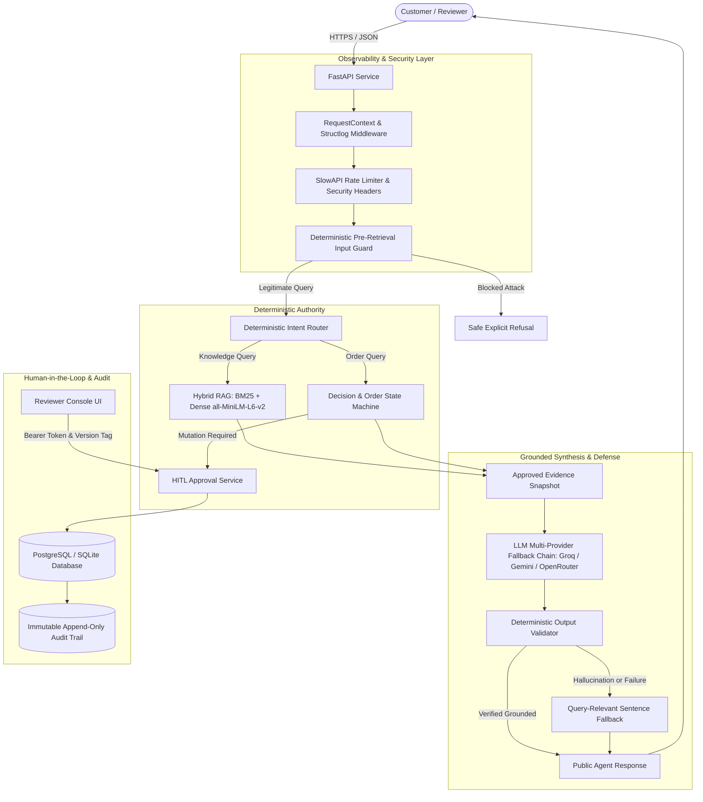

# Aster & Row AI Support Agent (v2.0.0)

[](https://github.com/aster-and-row/support-agent/actions/workflows/ci.yml)
[](https://github.com/aster-and-row/support-agent/actions/workflows/live_eval.yml)
[](SECURITY.md)

> A production-grade, highly observable, and accessible customer support agent for **Aster & Row** (outdoor gear, drinkware, and apparel) built on a strict **deterministic-first architecture**: hybrid BM25 + dense retrieval, strict policy authority, optimistic-concurrency human-in-the-loop approvals, PII redaction, and an audited WCAG 2.1 AA React frontend.

---

## Architecture

The LLM is strictly restricted to linguistic phrasing of verified facts. It has **zero authority** to decide eligibility, mutate orders, or bypass human review.



---

## Measured Performance & Evaluation Results

All numbers below are generated by the unified evaluation runner (`evaluation/run_suite.py`) across 430 real-world benchmark scenarios and committed in [`docs/results/`](docs/results/).

| Evaluation Dimension | Benchmark Dataset | Baseline (v1 / Step 1) | Final (v2.0.0) | Improvement / Delta | Gate Status |
| :--- | :--- | :--- | :--- | :--- | :--- |
| **Order Intent Accuracy** | `agent_decision` (140 cases) | **71.43%** | **100.00%** | **+28.57%** | PASS (>=95%) |
| **Deterministic Route Accuracy** | `agent_decision` (140 cases) | **92.86%** | **100.00%** | **+7.14%** | PASS (>=95%) |
| **Direct Prompt Injection Resistance** | `security_adversarial` (85 cases) | **8.33%** | **100.00%** | **+91.67%** | PASS (>=95%) |
| **Adversarial Attack Blocked Rate** | `security_adversarial` (85 cases) | **87.06%** | **100.00%** | **+12.94%** | PASS (>=90%) |
| **PII & Secret Disclosures** | `security_adversarial` (85 cases) | **0 leaks** | **0 leaks** | **0 secrets, 0 PII** | PASS (0 leaks) |
| **Fallback Claim Recall** | `answer_quality` (150 cases) | **18.11%** | **51.85%** | **+33.74%** | PASS (>=45%) |
| **Citation Coverage Rate** | `answer_quality` (150 cases) | **94.67%** | **94.67%** | **Maintained** | PASS (>=90%) |
| **Visible & Golden Scenarios** | Visible (15) + Regression (8) | **100.0%** | **100.0%** | **100% (23/23)** | PASS (>=95%) |
| **HITL Adversarial Attack Vectors** | `hitl_adversarial` (32 vectors) | **100.0%** | **100.0%** | **32/32 (0 mutations)**| PASS (100%) |

See full run manifests in [docs/results/baseline_v2.md](docs/results/baseline_v2.md) and [docs/results/final_v2.md](docs/results/final_v2.md).

---

## Features & Highlights

- **Full-Stack Observability**: Structured JSON logging via `structlog`, distributed `X-Request-ID` tracing, request latency histograms, Prometheus metrics endpoint (`/metrics`), Sentry exception tracking, and a provisioned Grafana dashboard. See [deploy/observability/](deploy/observability/).
- **Human-in-the-Loop (HITL) Workflow**: Sensitive actions (cancellations, address updates) are staged as proposals. Reviewers approve or reject via optimistic locking (`version` column) and an immutable append-only audit trail. See [ADR 0001: HITL Approvals](docs/adr/0001-hitl-approvals.md).
- **Accessible-First Frontend (WCAG 2.1 AA)**: Built with React, Vite, and TypeScript. Fully audited with `@axe-core/react`, `eslint-plugin-jsx-a11y`, and Playwright. Features semantic landmarks, live region announcements (`aria-live="polite"`), modal focus trapping, contrast token compliance, and 200% zoom reflow. See [docs/ACCESSIBILITY.md](docs/ACCESSIBILITY.md).
- **Security Hardening**: Pre-retrieval deterministic regex guard, `slowapi` rate limiting (60 req/min), 1MB payload limits, strict `CORS_ORIGINS`, and standard HTTP security headers (`nosniff`, `DENY`, `CSP`). Verified with zero known CVEs via `pip-audit` and `npm audit`. See [SECURITY.md](SECURITY.md).

---

## Quickstart (3 Commands)

Run the entire production stack (FastAPI backend, React frontend, PostgreSQL, Prometheus, and Grafana):

```bash
# 1. Clone repository and copy environment template
git clone <repository-url> && cd cometchat-ai-agent-intern-test
cp .env.example .env

# 2. Build and launch all containerized services
docker compose up -d

# 3. Verify services are healthy
docker compose ps
```

- **Customer Chat & Reviewer UI**: [http://localhost:80](http://localhost:80)
- **FastAPI Documentation**: [http://localhost:8000/docs](http://localhost:8000/docs)
- **Prometheus Metrics**: [http://localhost:9090](http://localhost:9090)
- **Grafana Observability Dashboard**: [http://localhost:3001](http://localhost:3001) (User: `admin`, Pass: `admin`)

---

## Local Development & Testing

### Python Backend
```bash
# Setup virtual environment
python3.11 -m venv .venv && source .venv/bin/activate
pip install -r requirements.txt -r requirements-dev.txt

# Run full pytest test suite
PYTHONPATH=. pytest

# Run evaluation suite against regression thresholds
PYTHONPATH=. python evaluation/run_suite.py --check-thresholds
```

### React Frontend
```bash
cd frontend
npm ci
npm test              # Run Vitest unit & accessibility tests
npm run lint          # Run ESLint with jsx-a11y plugin
npm run build         # Build production distribution
```

---

## Limitations & Boundaries
- **Order Mutations Require Humans**: The agent cannot directly cancel an order or modify a shipping address. It can only generate a proposal for a human reviewer to approve.
- **Rate Limiting**: Public endpoints default to 60 requests per minute per IP to defend against DoS.
- **Financial & Shipping APIs**: Out-of-scope; payment processing and warehouse courier dispatch are handled by external enterprise connectors.

---

## AI Assistance Disclosure
In accordance with engineering standards, this upgrade was developed with the assistance of Google Antigravity / Gemini code intelligence tooling. All architectural decisions, security invariants, regression thresholds, and code artifacts were verified against automated test suites and deterministic proof criteria.
