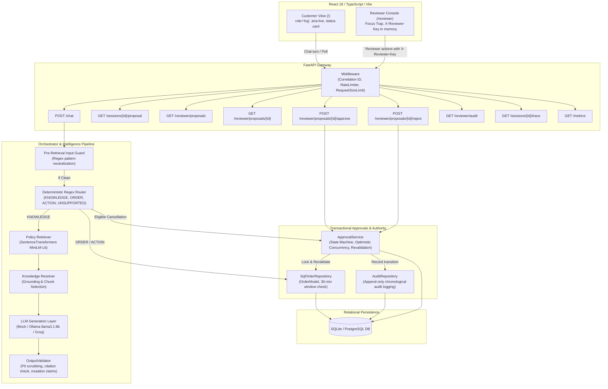
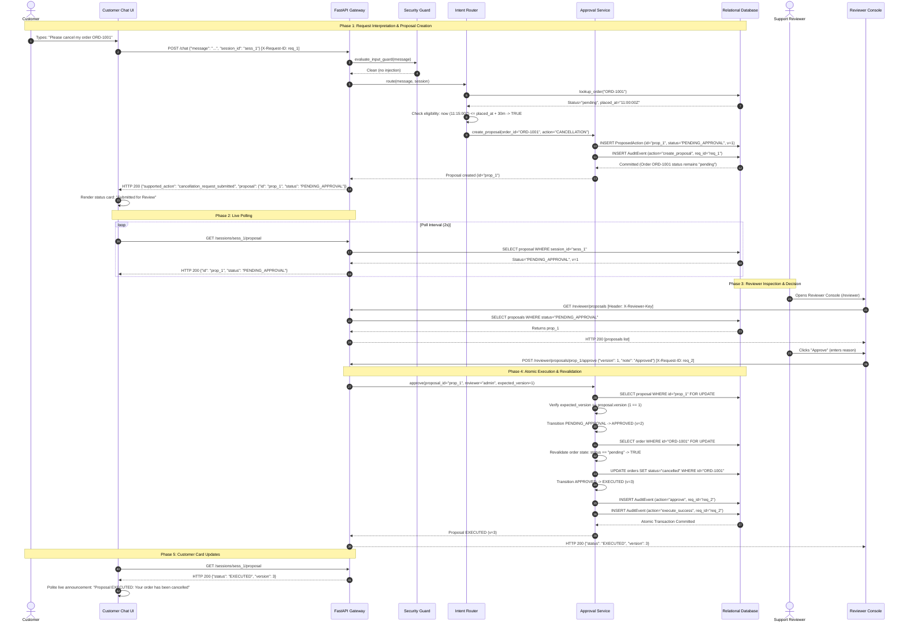
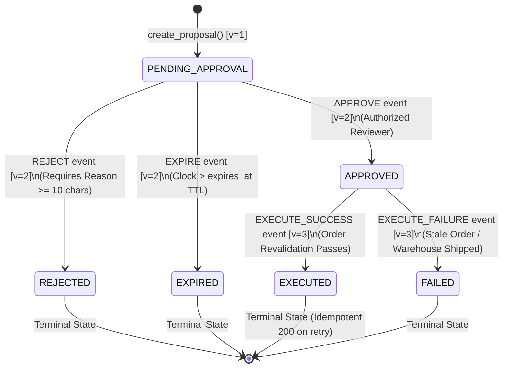

# Architecture and End-to-End Data Flow Specification

**Evaluation Artifact**: `evaluation/complete_customer_journey_2026_11_26/ARCHITECTURE_AND_DATA_FLOW.md`  
**System**: Aster & Row Customer Support System  
**Commit**: `663f5bbf50e42b90b497240ec466b4e74b19ec8a`

---

## 1. High-Level System Architecture

Aster & Row implements a deterministic-first customer service architecture. The generative LLM is restricted to phrasing policy answers and summarizing factual evidence. Business policies, state transitions, authentication, and database mutations are strictly decoupled and governed by Python state machines.



---

## 2. End-to-End Action Lifecycle Sequence Diagram

The complete sequence diagram below depicts the execution lifecycle of a customer cancellation request, illustrating the separation between proposal creation, human approval, state revalidation, and single-execution mutation.



---

## 3. Finite State Machine Formal Specification

The proposed action lifecycle is implemented in `src/approvals/state_machine.py` as an explicit finite state machine with strict transition guards.



### State Machine Transition Rules Table

| Current State | Event Trigger | Next State | Version Change | Pre-Conditions & Invariants |
|---|---|---|---|---|
| *(None)* | `CREATE` | `PENDING_APPROVAL` | `version = 1` | Order exists, status is `pending`, now <= placed_at + 30m. |
| `PENDING_APPROVAL` | `APPROVE` | `APPROVED` | `version += 1` | `expected_version == current_version`, caller is authenticated reviewer. |
| `APPROVED` | `EXECUTE_SUCCESS` | `EXECUTED` | `version += 1` | Database row revalidated; order status atomically updated to `cancelled`. |
| `APPROVED` | `EXECUTE_FAILURE` | `FAILED` | `version += 1` | Order revalidation failed (e.g. order was shipped by warehouse). |
| `PENDING_APPROVAL` | `REJECT` | `REJECTED` | `version += 1` | Rejection reason length is between 10 and 500 characters. |
| `PENDING_APPROVAL` | `EXPIRE` | `EXPIRED` | `version += 1` | System clock > proposal `expires_at` timestamp. |
| `EXECUTED` | `APPROVE` (Retry) | `EXECUTED` | `None` | **Idempotent No-Op**: Returns current state without second mutation. |

---

## 4. Formal Data Contracts

### A. Customer Chat Request (`ChatRequest`)
```json
{
  "message": "Please cancel my order ORD-1001 right now.",
  "session_id": "journey-cust-e32d4ba1"
}
```

### B. Public Agent Response (`ChatResponse`)
Customer responses contain only sanitized, customer-safe fields. Sensitive internal attributes (fraud scores, credit card tokens, warehouse notes) are stripped prior to response delivery.
```json
{
  "session_id": "journey-cust-e32d4ba1",
  "turn_id": 1,
  "message": "Your cancellation request for order ORD-1001 has been submitted for human review (reference: prop_f2a9f4e05b56).",
  "decision_state": "ANSWER",
  "citations": [
    "01-cancellation-policy.md > Standard Order Cancellation"
  ],
  "handoff_recommended": false,
  "handoff_reason": null,
  "supported_action": "cancellation_request_submitted",
  "is_fallback": false,
  "fallback_reason": null,
  "safe_order": {
    "order_id": "ORD-1001",
    "customer_id": "CUST-401",
    "status": "pending",
    "item_count": 2,
    "items_summary": "1x Horizon Daypack, 1x Breeze Tumbler",
    "tracking_number": null,
    "estimated_delivery": null
  },
  "proposal": {
    "id": "prop_f2a9f4e05b56",
    "order_id": "ORD-1001",
    "action_type": "CANCELLATION",
    "status": "PENDING_APPROVAL",
    "created_at": "2026-11-25T21:07:14.500985Z",
    "expires_at": "2026-11-26T21:07:14.500985Z",
    "version": 1
  }
}
```

### C. Reviewer Decision Payload (`ApproveProposalRequest` / `RejectProposalRequest`)
```json
{
  "version": 1,
  "note": "Customer submitted cancellation within 30-minute window. Order verified pending."
}
```

### D. Audit Event Entity (`AuditEventResponse`)
All transitions generate permanent, append-only audit records.
```json
{
  "id": "evt_91f4b2a8",
  "proposal_id": "prop_f2a9f4e05b56",
  "order_id": "ORD-1001",
  "action": "execute_success",
  "actor": "admin",
  "actor_type": "human_reviewer",
  "previous_status": "APPROVED",
  "new_status": "EXECUTED",
  "version": 3,
  "timestamp": "2026-11-25T21:07:14.510277Z",
  "request_id": "req-rev-appr-77403d25",
  "details": {
    "order_id": "ORD-1001",
    "previous_order_status": "pending",
    "new_order_status": "cancelled",
    "mutation_executed_at": "2026-03-01T11:15:00Z"
  }
}
```
