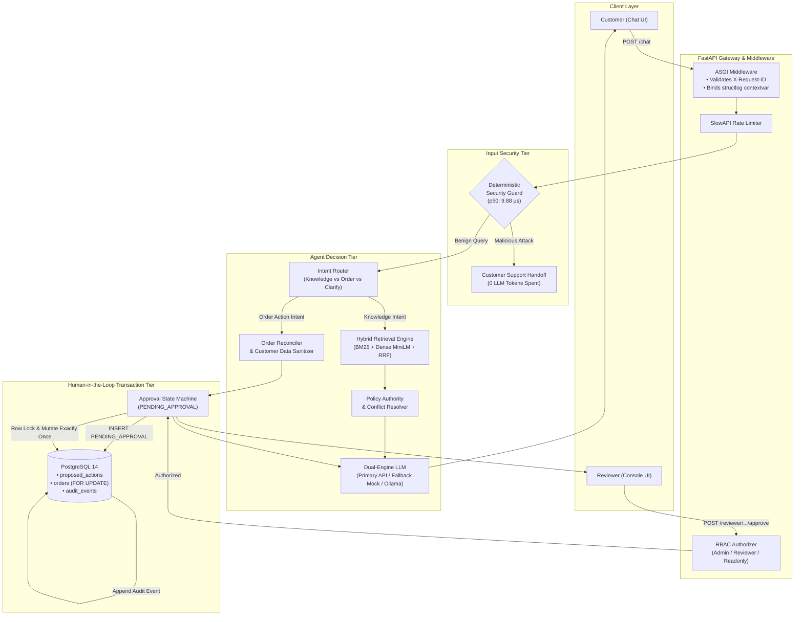

# Aster & Row Architecture & Data Flow Guide

---

## 1. System Architecture

Aster & Row is constructed around 5 primary architectural tiers:

1. **API Gateway (`src/api.py`)**:
   - Built on FastAPI with asynchronous event loop processing.
   - ASGI Observability Middleware (`src/observability/request_context.py`) validating and echoing `X-Request-ID`.
   - Rate limiting via `slowapi` (`Limiter(key_func=get_remote_address)`).
   - Role-Based Access Control (`src/approvals/auth.py`) protecting reviewer operational endpoints.
   - Centralized exception handlers preventing raw stack traces or internal secrets from leaking to clients.

2. **Pre-Retrieval Security Guard (`src/agent/security_guard.py`)**:
   - Ultra-low latency regex scanner executed prior to vector retrieval or LLM inference.
   - Evaluates instruction overrides, role-play attempts, secret exfiltration, customer PII scraping, SQL injection, and token forgery in under **10 µs**.
   - Attacks are safely routed directly to customer service handoff without consuming LLM tokens.

3. **Hybrid Retrieval & Policy Engine (`src/retrieval/`, `src/knowledge/`)**:
   - **BM25 Inverted Index (`src/retrieval/bm25.py`)**: Exact keyword, sku, and clause matching using Rank-BM25 with normalized tokenization.
   - **Dense Semantic Index (`src/retrieval/dense.py`)**: MiniLM (`all-MiniLM-L6-v2`) 384-dimensional embeddings for intent and semantic nuance matching.
   - **Reciprocal Rank Fusion (RRF) (`src/retrieval/fusion.py`)**: Fuses disparate ranking distributions into a unified, high-recall candidate set.
   - **Authority & Conflict Resolver (`src/knowledge/authority.py`, `src/knowledge/conflict.py`)**: Detects policy discrepancies between legacy and current documents, applying supersession rules to provide unambiguous citations.

4. **Agent Orchestrator & Decision Engine (`src/agent/orchestrator.py`)**:
   - Deterministic finite state machine managing conversational turns, session state, and order tools.
   - Reconciles raw ERP database records into customer-safe order representations (`CustomerSafeOrder`) stripping warehouse notes, fraud scores, and supplier costs.
   - Enforces human-in-the-loop action boundaries: customer cancellation and address change requests generate persistent approval proposals rather than mutating order records directly.

5. **Human-in-the-Loop Approval State Machine (`src/approvals/`)**:
   - Backed by PostgreSQL with optimistic concurrency control (`version` checking) and pessimistic row locks (`SELECT ... FOR UPDATE`).
   - Lifecycle states: `PENDING_APPROVAL` → `APPROVED` → `EXECUTED` (or `REJECTED`, `EXPIRED`, `FAILED`).
   - Atomic revalidation: When a reviewer approves an action, the system re-queries and locks the target order row, verifying that the order has not transitioned to an ineligible state (e.g. warehouse shipment) before executing the mutation.
   - Immutable audit repository recording every state transition with timestamp, acting principal, rationale, and correlated request ID.

---

## 2. End-to-End Data Flow Diagram

