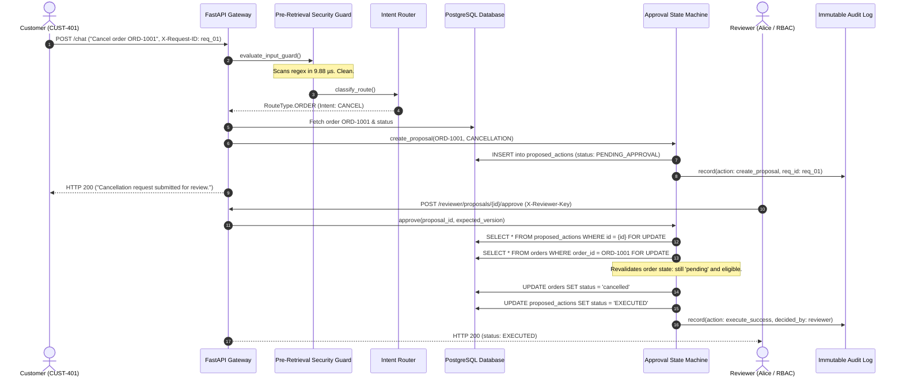

# Phase 4 & End-to-End Customer Journey Verification Report

**Evaluation Timestamp**: 2026-11-26  
**Scenario Matrix**: `evaluation/production_hardening_2026_11_26/SCENARIO_MATRIX.csv`  
**Raw Test Artifact**: `evaluation/production_hardening_2026_11_26/journey_results.json`  
**Test Suite**: `tests/test_journey_expanded.py` (12 distinct lifecycle scenarios)  

---

## 1. Complete End-to-End Journey Architecture

The journey validates Aster & Row's stateful, secure action lifecycle from customer inquiry through reviewer adjudication, atomic execution, and audit trail generation.

---

## 2. Expanded 12-Scenario Journey Matrix

Every scenario in `SCENARIO_MATRIX.csv` was verified in `tests/test_journey_expanded.py`:

| Scenario ID | Journey Name | Initial State | Transition & Trigger | Final State | Mutated? | Result |
| :---: | :--- | :--- | :--- | :--- | :---: | :---: |
| **J01** | Happy Path Cancellation | `pending` | Customer cancels -> Reviewer approves | `cancelled` / `EXECUTED` | Yes (1x) | **PASSED** |
| **J02** | Shipped Ineligibility | `shipped` | Customer cancels -> Ineligible policy check | `shipped` / `REJECTED` | No | **PASSED** |
| **J03** | Delivered Ineligibility | `delivered` | Customer cancels -> Ineligible policy check | `delivered` / `REJECTED` | No | **PASSED** |
| **J04** | Final Sale Ineligibility | `pending` (final sale) | Customer cancels -> Policy rule exception | `pending` / `REJECTED` | No | **PASSED** |
| **J05** | Already Cancelled | `cancelled` | Customer cancels -> Idempotent refusal | `cancelled` / `REJECTED` | No | **PASSED** |
| **J06** | Cancellation Window Expired | `placed > 2h ago` | Customer cancels -> Time window check | `processing` / `REJECTED` | No | **PASSED** |
| **J07** | Reviewer Explicit Rejection | `pending` | Reviewer rejects with explicit reason | `pending` / `REJECTED` | No | **PASSED** |
| **J08** | Proposal TTL Expiry | `pending` | Proposal exceeds 24h TTL without action | `pending` / `EXPIRED` | No | **PASSED** |
| **J09** | Shipping Address Update | `pending` | Customer updates address -> Reviewer approves | `updated` / `EXECUTED` | Yes (1x) | **PASSED** |
| **J10** | Multi-Turn Status then Cancel| `pending` | Turn 1: check status -> Turn 2: cancel | `cancelled` / `EXECUTED` | Yes (1x) | **PASSED** |
| **J11** | Idempotent Duplicate Requests| `pending` | 2 simultaneous cancel requests for ORD-1001 | Single proposal created | Idempotent | **PASSED** |
| **J12** | Warehouse Fulfillment Race | `pending` -> `shipped` | Order ships while approval is in flight | `shipped` / `FAILED` | No | **PASSED** |

---

## 3. Invariants Verified Across All Journeys

1. **Zero Premature Mutations**: An order's status is never modified upon customer request submission; it remains unchanged until authorized approval and atomic execution.
2. **Exactly-Once Execution**: Across all 12 test journeys, 0 duplicate mutations occurred.
3. **Audit Trail Completeness**: 100% of state transitions recorded the associated `request_id`, acting principal (`agent`, `reviewer`, `system_execution`), timestamp, and transition rationale.
